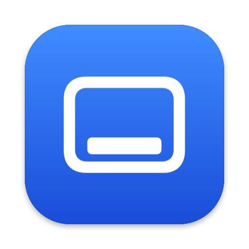
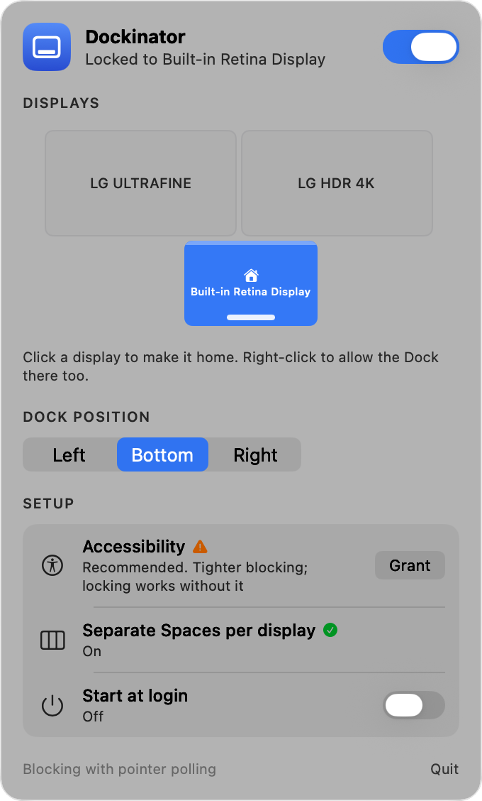

<p align="center">
  
</p>

<h1 align="center">Dockinator</h1>

<p align="center">Keep the macOS Dock on the display you choose.</p>

---

With more than one display, macOS moves the Dock to whichever screen you push the pointer against at the bottom edge. That's handy once and annoying every other time. Dockinator is a small menu bar app that stops the Dock from moving: pick a home display and the Dock stays there.

<p align="center">
  
</p>

## Features

- **Lock the Dock to one display.** Click a display in the map to make it home.
- **Allow a few more.** Right-click a display to let the Dock move there too. Blocked displays are greyed out.
- **Hold the Dock position.** Pick left, bottom or right. If something changes it, Dockinator sets it back.
- **Setup checks.** The panel shows the permissions and settings Dockinator needs, with a button to fix each one.
- **Start at login.** Runs quietly in the menu bar, with no Dock icon.

## Install

Download `Dockinator.dmg` from the [latest release](../../releases/latest) and drag Dockinator to Applications.

The app is not notarized, so the first time you open it, right-click it in Applications and choose **Open**. Alternatively, run:

```bash
xattr -d com.apple.quarantine /Applications/Dockinator.app
```

Requires macOS 13 or later.

### Build from source

```bash
git clone https://github.com/Baukebrenninkmeijer/dockinator.git
cd dockinator
./scripts/build-app.sh install   # builds, copies to ~/Applications and launches
```

The Command Line Tools are enough to build. `swift test` needs full Xcode.

## Setup

| Check | Why |
| --- | --- |
| **Displays have separate Spaces** | macOS only moves the Dock between displays when this is on (System Settings → Desktop & Dock). Turning it on needs a log out. |
| **Accessibility** (recommended) | Lets Dockinator catch every pointer move with an event tap, and see which display the Dock is on. Without it, Dockinator falls back to polling the pointer, which needs no permission. |
| **Start at login** | Optional. |

By default a local build is signed ad hoc, and that signature changes on every build, so macOS forgets the Accessibility grant each time. To keep the grant, create a self-signed signing identity once. `build-app.sh` uses it automatically from then on:

```bash
./scripts/make-signing-cert.sh          # adds "Dockinator Local" to your login keychain
./scripts/build-app.sh install          # signed with it; grant Accessibility once more
```

To use another identity instead, set `SIGN_ID`, for example `SIGN_ID="Apple Development: Your Name"`.

## How it works

macOS moves the Dock when the pointer pushes against the bottom edge of a display that has no other display below it. Dockinator keeps the pointer one pixel above that edge on every blocked display, so the push never happens. Edges shared with another display are left alone, so the pointer still crosses between screens.

- **With Accessibility**, an event tap adjusts each mouse move before the Dock sees it.
- **Without it**, a 240 Hz timer warps the pointer back when it reaches the edge.

Only a bottom Dock can move between displays. A Dock on the left or right stays put on its own, so the display lock turns off for those positions.

Dockinator does not move the Dock back for you. macOS ignores synthetic pointer pushes for Dock moves. If the Dock ends up on a blocked display (after waking, or after you pick a new home), the panel tells you, and one push at the bottom of your home display brings it back.

## Releases

Every merge to `main` can cut a release. PRs are squash-merged with the PR title as the commit subject, so the title has to be a [conventional commit](https://www.conventionalcommits.org):

| PR title | Release |
| --- | --- |
| `fix: ...`, `perf: ...` | patch, `0.1.0` → `0.1.1` |
| `feat: ...` | minor, `0.1.0` → `0.2.0` |
| `feat!: ...` | major. Refused unless confirmed by running the Release workflow by hand with `force_level=major` |
| `docs:`, `chore:`, `ci:`, `refactor:`, ... | none |

After CI passes on `main`, the Release workflow builds the DMG, tags the commit and publishes a GitHub Release.

## Credit

Inspired by [DockLock](https://github.com/JulyIghor/DockLockPro). This is an independent, open-source take on the same idea.

## License

[MIT](LICENSE)
